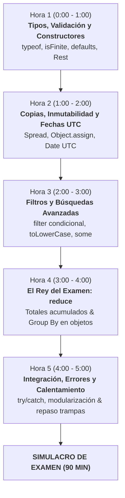

# Plan de Choque Intensivo (5 Horas) — Preparación de Examen DWEC
**Objetivo:** Dominar los patrones de código exactos que evalúa el profesor en la Unidad 2, Fundamentos JS (I, II y III) y la Actividad Variada. Al finalizar estas 5 horas, realizarás el simulacro de examen.

---

## 1. Cronograma de Estudio Intensivo (Bloques de 50 min + 10 min descanso)



---

### HORA 1 (0:00 - 1:00): Tipos, Coerción, Validación y Constructores
- **Qué repasar (20 min):**
  - Entender las salidas de `typeof` (especialmente `"object"` para `null` y `[]`).
  - Reglas de parámetros por defecto: solo se activan con argumento ausente o `undefined`; `null` se respeta.
  - El operador Rest `...etiquetas` en la cabecera del constructor.
- **Qué programar en tu editor (30 min):**
  - Escribe de memoria la función `esNumeroValido(n)` en Node.
  - Implementa el constructor [`CrearGasto`](file:///c:/Users/javie/Desktop/cosasgit/gestorPresupuesto/js/gestionPresupuesto.js#L25) y el constructor `Partida` ([`actividad_videojuegos_JavierIniesta.js`](file:///c:/Users/javie/Desktop/cosasgit/gestorPresupuesto/actividadVariada/actividad_videojuegos_JavierIniesta.js#L124)).
  - Añade un método al constructor (ej. `sumarPuntos(extra = 100)` o `actualizarValor(nuevoValor)`).

---

### HORA 2 (1:00 - 2:00): Copias Superficiales (*Shallow Copy*) y Fechas UTC
- **Qué repasar (20 min):**
  - Diferencia entre asignar referencia (`b = a`) vs clonar superficialmente (`{ ...a }` u `Object.assign({}, a)`).
  - Por qué las referencias anidadas (arrays de etiquetas) se comparten tras una copia superficial.
  - Manejo de fechas UTC: `getTime()`, `getUTCFullYear()`, `getUTCMonth() + 1` (¡recordar la base 0!), `getUTCDate()`.
- **Qué programar en tu editor (30 min):**
  - Función de copias: `const copia = { ...original, prop: nuevoValor };` y con `Object.assign`.
  - Función `diasEntre(inicio, fin)` calculando la diferencia entre timestamps dividida por $86.400.000$.
  - Validación de fechas con `Date.parse(str)` (comprobar que no dé `NaN`).

---

### HORA 3 (2:00 - 3:00): Filtrado Declarativo y Búsquedas Avanzadas
- **Qué repasar (20 min):**
  - `Array.prototype.filter()` y `Array.prototype.find()`.
  - Tratamiento de filtros opcionales: `parametro === undefined || item.campo === parametro`.
  - Comparaciones de cadenas insensibles a mayúsculas/minúsculas con `.toLowerCase().includes()`.
  - Búsqueda en arrays de etiquetas con `.some()`.
- **Qué programar en tu editor (30 min):**
  - Replica la función `filtrarPartidas` de la actividad de videojuegos.
  - Replica [`filtrarGastos`](file:///c:/Users/javie/Desktop/cosasgit/gestorPresupuesto/js/gestionPresupuesto.js#L130) del gestor de presupuesto manejando el objeto de filtros (`fechaDesde`, `fechaHasta`, `valorMinimo`, `descripcionContiene`, `etiquetasTiene`).

---

### HORA 4 (3:00 - 4:00): Dominio Total de `reduce` (Totales y Agrupaciones)
- **Qué repasar (15 min):**
  - La estructura de `reduce((acumulador, elemento) => { ... return acumulador; }, valorInicial)`.
  - **Peligro mortal:** Olvidar el `return acumulador;` o no pasar el segundo parámetro (`0` o `{}`).
  - El patrón "Group By": acumular valores en propiedades dinámicas de un objeto.
- **Qué programar en tu editor (35 min):**
  - Suma total con `reduce`: `totalPuntos` y [`calcularTotalGastos`](file:///c:/Users/javie/Desktop/cosasgit/gestorPresupuesto/js/gestionPresupuesto.js#L122).
  - Agrupación por clave: `puntosPorJuego` de videojuegos.
  - Agrupación por fecha temporal: [`agruparGastos`](file:///c:/Users/javie/Desktop/cosasgit/gestorPresupuesto/js/gestionPresupuesto.js#L159) combinando filtrado + `reduce`.

---

### HORA 5 (4:00 - 5:00): Integración, Errores, Modularización y Calentamiento
- **Qué repasar (20 min):**
  - Manejo de excepciones: `try...catch(error) { ... } finally { ... }` y `throw new Error(...)`.
  - Modo estricto `"use strict";` en la línea 1.
  - `export { func1, func2 }` y formateo de cadenas con `.toLocaleString()`.
- **Qué programar en tu editor (30 min):**
  - Ejecuta en la terminal de tu proyecto:
    ```bash
    npm run test1
    npm run test2
    npm run test3
    ```
  - Ejecuta `node actividadVariada/actividad_videojuegos_JavierIniesta.js` y asegúrate de entender cada uno de los `OK` del comprobador.
  - ¡Listo para pedir el simulacro!

---

## 2. Chuleta de Patrones de Oro (Imprescindibles para el Examen)

### Patrón 1: Validación Numérica Fina
```javascript
const esNumeroValido = numero => 
  typeof numero === "number" && Number.isFinite(numero) && numero >= 0;
```

### Patrón 2: Constructor con Defaults y Rest
```javascript
function Partida(juego, minutos, puntos = 0, ...etiquetas) {
  this.juego = juego;
  this.minutos = minutos;
  this.puntos = puntos;       // undefined toma 0; null conserva null
  this.etiquetas = etiquetas; // Rest reúne los argumentos sobrantes en un Array

  this.sumarPuntos = function(extra = 100) {
    if (!esNumeroValido(extra)) return false;
    this.puntos += extra;
    return true;
  };
}
```

### Patrón 3: Copias Superficiales Inmutables
```javascript
// Con Spread (recomendado):
const copiaSpread = { ...original, genero: "exploracion" };

// Con Object.assign (el primer argumento DEBE ser {}):
const copiaAssign = Object.assign({}, original, { genero: "exploracion" });

// Copia de array:
const copiaArray = [...lista];

// Comprobación de shallow copy:
// copiaSpread.etiquetas === original.etiquetas -> true (comparten referencia)
```

### Patrón 4: Fechas UTC y Diferencia de Días
```javascript
function describirFecha(fechaISO) {
  const fecha = new Date(fechaISO);
  if (!Number.isFinite(fecha.getTime())) return null;

  return {
    timestamp: fecha.getTime(),
    anio: fecha.getUTCFullYear(),
    mes: fecha.getUTCMonth() + 1, // ¡OJO! Base 0, sumamos 1
    dia: fecha.getUTCDate()        // ¡OJO! getUTCDate, NO getUTCDay
  };
}

function diasEntre(inicio, fin) {
  const a = new Date(inicio).getTime();
  const b = new Date(fin).getTime();
  if (isNaN(a) || isNaN(b)) return null;
  return (b - a) / 86400000; // Milisegundos de un día (24 * 60 * 60 * 1000)
}
```

### Patrón 5: Filtro Flexible con Parámetros Opcionales
```javascript
function filtrarPartidas(lista, genero, minimo = 0) {
  return lista.filter(partida => {
    const cumpleDuracion = partida.minutos >= minimo;
    // Si genero es undefined, no restringe; si viene un valor (incluso null), debe coincidir:
    const cumpleGenero = genero === undefined || partida.genero === genero;
    return cumpleDuracion && cumpleGenero;
  });
}
```

### Patrón 6: El Rey — Acumulación y Agrupación con `reduce`
```javascript
// 1. Suma total numérica:
const total = lista.reduce((acumulado, item) => acumulado + item.puntos, 0);

// 2. Agrupación por clave dinámica (Group By):
const agrupado = lista.reduce((acc, item) => {
  // Si la clave no existe en el objeto acumulador, se inicializa:
  if (acc[item.juego] === undefined) {
    acc[item.juego] = 0;
  }
  acc[item.juego] += item.puntos;
  return acc; // ¡NUNCA OLVIDES DEVOLVER EL ACUMULADOR!
}, {});
```

### Patrón 7: Gestión de Etiquetas (Evitar Duplicados y Filtrar)
```javascript
// Añadir etiquetas sin duplicados:
this.anyadirEtiquetas = function(...nuevas) {
  for (let et of nuevas) {
    if (!this.etiquetas.includes(et)) {
      this.etiquetas.push(et);
    }
  }
};

// Borrar etiquetas:
this.borrarEtiquetas = function(...aBorrar) {
  this.etiquetas = this.etiquetas.filter(et => !aBorrar.includes(et));
};
```

---

## 3. Las 6 Trampas Letales de Examen

1. **`typeof null === "object"`**: Si te piden comprobar si algo es un objeto, `typeof x === "object"` dará `true` para `null`. Siempre añade `x !== null && typeof x === "object"`.
2. **`undefined` vs `null` en cabeceras de función**:  
   `function f(x = 5)` $\to$ `f(undefined)` da `5`. Pero `f(null)` da `null`.
3. **El mes en `Date`**:  
   `new Date("2026-10-18").getUTCMonth()` devuelve `9`, no `10`. Si olvidas sumar `1`, fallarás los tests.
4. **`getDate()` vs `getDay()`**:  
   `getDate()` / `getUTCDate()` devuelve el día del mes (1-31).  
   `getDay()` / `getUTCDay()` devuelve el día de la semana (0 = Domingo).
5. **Olvidar el valor inicial en `reduce`**:  
   `[].reduce((a, b) => a + b)` lanza un `TypeError`. Siempre pasa `0` o `{}` como segundo argumento.
6. **Comparaciones de texto sensibles a mayúsculas**:  
   Usa siempre `.toLowerCase()` en ambos lados para búsquedas:  
   `gasto.descripcion.toLowerCase().includes(busqueda.toLowerCase())`.
