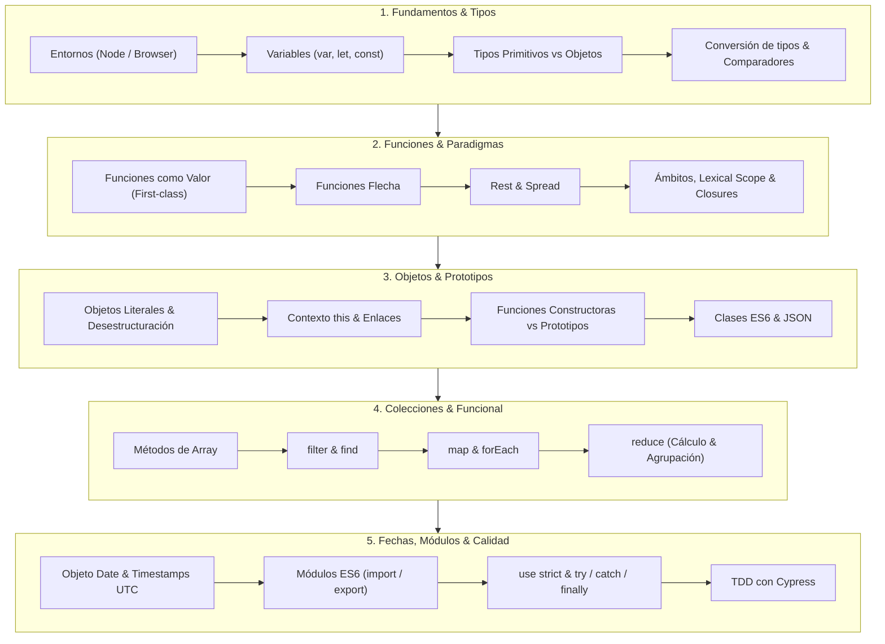
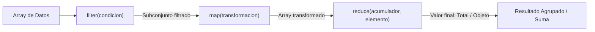

# Resumen Completo de la Unidad 2 y Plan de Estudio
**Módulo:** Desarrollo Web en Entorno Cliente (DWEC) — 2.º DAW  
**Materiales integrados:**
1. **Unidad 2 (UD2.pdf):** Introducción a JavaScript (88 diapositivas)
2. **Prácticas de Fundamentos JS (I, II y III):** Proyecto Gestor de Presupuesto ([`gestionPresupuesto.js`](file:///c:/Users/javie/Desktop/cosasgit/gestorPresupuesto/js/gestionPresupuesto.js))
3. **Actividades Variadas:** Examen práctico de 90 min "Club de Videojuegos" ([`Actividad_C_Videojuegos_90min.pdf`](file:///c:/Users/javie/Desktop/cosasgit/gestorPresupuesto/actividadVariada/Actividad_C_Videojuegos_90min.pdf) y [`actividad_videojuegos_JavierIniesta.js`](file:///c:/Users/javie/Desktop/cosasgit/gestorPresupuesto/actividadVariada/actividad_videojuegos_JavierIniesta.js))

---

## PARTE 1: Resumen Integral del Temario



---

### Bloque 1: Fundamentos del Lenguaje, Variables y Tipos de Datos

#### 1. Entorno de Ejecución
- **Navegador:** Ejecución en cliente. Se integra en HTML mediante `<script>` o `<script src="archivo.js">`. Dispone de la API Web global (`window`, `document`, `alert`, `prompt`, `confirm`).
- **Node.js:** Entorno de servidor basado en el motor V8. No tiene `window` ni cuadros de diálogo web; su objeto global es `global` (o el estándar universal `globalThis`). Común a ambos: `console.log()`.

#### 2. Declaración de Variables y Ámbito Léxico (*Lexical Scope*)
- `var`: Ámbito de función (o global si se declara fuera). Permite redeclaración y sufre de *hoisting* con inicialización en `undefined`. Obsoleta en JS moderno.
- `let`: Ámbito de bloque `{ ... }`. Recomendada para variables mutables y contadores de bucles.
- `const`: Ámbito de bloque. No permite reasignación de identificador (aunque si contiene un objeto o array, sus propiedades internas sí pueden mutar).
- **Ámbito Léxico:** Las funciones y bloques resuelven variables buscando desde el entorno interior hacia el exterior hasta llegar a la raíz (objeto global o módulo). Las variables locales **enmascaran** a las exteriores con el mismo nombre.
- **Buenas prácticas:** Minimizar el uso de variables globales. Usar siempre `let` en bucles para evitar fugas de ámbito.

#### 3. Tipos de Datos
- **Primitivos (inmutables, paso por valor):**
  - `number`: Números de 64 bits flotantes (enteros y decimales). Valores especiales: `NaN` (*Not a Number*), `Infinity`, `-Infinity`.
  - `bigint`: Números enteros de precisión arbitraria.
  - `string`: Cadenas de caracteres.
  - `boolean`: `true` o `false`.
  - `null`: Representa la ausencia intencional de valor.
  - `undefined`: Variable declarada sin valor asignado, parámetro omitido o propiedad inexistente.
  - `symbol`: Identificadores únicos e inmutables.
- **Compuestos (mutables, paso por referencia):**
  - `object`: Estructuras clave-valor (incluye Arrays, Funciones, Date, RegExp, etc.).

> [!WARNING]
> **Peculiaridad histórica de `typeof`:**  
> `typeof null` devuelve `"object"` por un error de diseño de las primeras versiones de JS.  
> Para comprobar si un valor es `null` de forma segura, se debe usar igualdad estricta: `valor === null`.  
> Para comprobar si es un array, no sirve `typeof []` (da `"object"`), sino `Array.isArray([]) === true`.

```javascript
// Comprobaciones de tipos críticas (como en la Actividad Variada y Fundamentos I):
typeof 1200;            // "number"
typeof "1200";          // "string"
typeof true;            // "boolean"
typeof undefined;       // "undefined"
typeof null;            // "object"  <-- ¡Ojo en exámenes!
typeof [];              // "object"
typeof (() => {});      // "function"
Array.isArray([]);      // true

// Validación robusta de un número no negativo finito:
const esNumeroValido = numero => 
  typeof numero === "number" && Number.isFinite(numero) && numero >= 0;
```

#### 4. Conversión de Tipos y Comparaciones
- **Conversión a Número:**
  - `undefined` $\to$ `NaN`
  - `null` $\to$ `0`
  - `true` / `false` $\to$ `1` / `0`
  - `""` (vacía) $\to$ `0`, `"123"` $\to$ `123`, `"hola"` $\to$ `NaN`
  - Métodos: `Number(v)`, `parseInt(v, 10)`, `parseFloat(v)`, o el operador unario `+v`.
  - Comprobación: `Number.isNaN(v)` o `Number.isFinite(v)`.
- **Conversión a Booleano:**
  - Valores **Falsy**: `0`, `0n`, `""`, `null`, `undefined`, `NaN`, `false`.
  - Valores **Truthy**: Todo lo demás (incluyendo `"0"`, `"false"`, `[]`, `{}`).
- **Operador Suma (`+`):** Si cualquiera de los dos operandos es un `string`, actúa como **concatenador**. Los demás operadores (`-`, `*`, `/`, `%`) siempre fuerzan conversión numérica.
- **Comparación estricta (`===`) vs no estricta (`==`):**
  - `===` compara valor y tipo sin coerción.
  - `==` realiza conversiones implícitas (por ejemplo, `0 == false` es `true`, pero `0 === false` es `false`).
  - Caso especial: `null == undefined` es `true`, pero `null === undefined` es `false`.

#### 5. Strings y Template Literals
- Comillas dobles `""`, simples `''`.
- Plantillas de texto con comillas invertidas (*backticks*) `` `...` ``:
  - Permiten textos multilínea sin caracteres de escape `\n`.
  - Interpolación directa de expresiones: `${expresion}`.

#### 6. Estructuras de Control e Iteración
- Condicionales: `if...else`, `switch...case`, operador ternario `condicion ? valorSi : valorNo`.
- Bucles: `while`, `do...while`, `for(let i=0; i<n; i++)`.
- `for...of`: Itera sobre los **valores** de objetos iterables (Arrays, Strings, Sets). Es la forma recomendada para recorrer arrays.
- `for...in`: Itera sobre las **claves/propiedades enumerables** de un objeto. No recomendable para arrays (es más lento e itera propiedades no numéricas del prototipo).

---

### Bloque 2: Funciones, Operadores Rest/Spread y Closures

#### 1. Funciones como Ciudadanos de Primera Clase (*First-Class Citizens*)
En JavaScript, las funciones son objetos:
- Se pueden almacenar en variables o estructuras de datos.
- Se pueden pasar como argumentos a otras funciones (**callbacks**).
- Se pueden retornar desde otras funciones (**funciones de orden superior**).

#### 2. Declaración vs Expresión vs Funciones Flecha
- **Declaración:** `function suma(a, b) { return a + b; }` (sufre hoisting completo).
- **Expresión de función:** `const suma = function(a, b) { return a + b; };`
- **Funciones Flecha (*Arrow Functions*):** `const suma = (a, b) => a + b;`
  - Sintaxis concisa: omiten `function`, y si tienen una sola expresión omiten `{}` y `return`.
  - **Diferencias esenciales frente a funciones estándar:**
    1. Son siempre anónimas.
    2. **No tienen su propio `this`**: capturan el `this` del contexto léxico donde fueron creadas.
    3. No tienen objeto `arguments`.
    4. No pueden usarse como funciones constructoras (lanzan error si se invocan con `new`).
    5. No admiten re-enlace con `.call()`, `.apply()` o `.bind()`.

#### 3. Parámetros por Defecto, Rest y Spread
- **Parámetros por defecto:** `function test(x = 100)`
  - Se aplican cuando el argumento es omitido o se pasa explícitamente `undefined`.
  - **No se aplican si se pasa `null`** (se conserva `null`).
- **Operador Rest (`...param`):** En la definición de la función, agrupa un número indeterminado de argumentos restantes en un Array real. Debe situarse siempre en la última posición:
  ```javascript
  function CrearGasto(descripcion, valor, fecha, ...etiquetas) { ... }
  ```
- **Operador Spread (`...iterable`):** En llamadas a funciones o literales, expande los elementos de un array u objeto:
  ```javascript
  const lista = ["casa", "comida"];
  gasto.anyadirEtiquetas(...lista); // Equivale a pasar "casa", "comida" por separado
  ```

#### 4. Ámbitos y *Closures* (Clausuras)
Un **closure** es la combinación de una función y el entorno léxico en el cual fue creada. Permite que una función interna acceda a las variables de una función contenedora incluso después de que esta última haya terminado de ejecutarse:
```javascript
function crearContador() {
  let cuenta = 0; // Variable privada encerrada en el closure
  return function() {
    cuenta++;
    return cuenta;
  };
}
const miContador = crearContador();
console.log(miContador()); // 1
console.log(miContador()); // 2
```

---

### Bloque 3: Objetos, Prototipos, Clases y Fechas

#### 1. Principios de Objetos y Copias
- Declaración literal: `const obj = { clave: valor };`
- Acceso a propiedades inexistentes: Devuelve `undefined` sin arrojar error.
- Operador `in`: Comprueba si una propiedad existe (`"color" in coche`).
- **Paso por referencia vs Copia superficial (*Shallow Copy*):**
  - Si se asigna `const b = a`, ambas variables apuntan a la misma dirección de memoria.
  - Para crear una copia superficial independiente:
    - Con Spread: `const copia = { ...original, propiedadModificada: valor };`
    - Con `Object.assign`: `const copia = Object.assign({}, original, { propiedadModificada: valor });`
  - En copias superficiales, si el objeto original contiene propiedades que son a su vez objetos o arrays (como `etiquetas: []`), **la referencia interna se sigue compartiendo** (`copia.etiquetas === original.etiquetas`).

#### 2. El Contexto `this` y sus Reglas de Vinculación
El valor de `this` se determina en el momento en que se **invoca** la función (salvo en funciones flecha):
1. **Con operador `new`:** `this` apunta a la nueva instancia recién creada.
2. **Llamada como método de objeto (`obj.metodo()`):** `this` apunta al objeto `obj` (enlace implícito).
3. **Enlace explícito (`call`, `apply`, `bind`):**
   - `func.call(contexto, arg1, arg2)` ejecuta inmediatamente con ese `this`.
   - `func.apply(contexto, [args])` igual, pero pasando argumentos en un array.
   - `func.bind(contexto)` devuelve una nueva función con el `this` fijado permanentemente.
4. **Llamada a función suelta (`func()`):** En modo normal apunta al objeto global (`window` / `global`); en modo estricto (`"use strict"`) vale `undefined`.
5. **Problema clásico en callbacks (`setTimeout`, event listeners):** El callback pierde la referencia al objeto receptor. Solución: usar `.bind(this)` o una función flecha `() => this.metodo()`.

#### 3. Prototipos y Funciones Constructoras
JavaScript no implementa clases clásicas basadas en copia de métodos, sino **herencia prototípica mediante delegación**:
- Cada objeto tiene un enlace interno a su prototipo (`[[Prototype]]`). Si una propiedad o método no se encuentra en el objeto, el motor busca por la cadena de prototipos hasta llegar a `Object.prototype`.
- **Funciones Constructoras:**
  - Se nombran por convención en PascalCase (`function CrearGasto(...)`).
  - Se invocan con `new`.
  - Inyectan propiedades al `this`.
  - Comportamiento de `return`: Si retorna explícitamente un objeto, se devuelve dicho objeto; si retorna un primitivo o nada, se ignora y se devuelve `this`.
  - Métodos compartidos pueden definirse en `CrearGasto.prototype.metodo = function() { ... }` para ahorrar memoria.
- **Clases en ES6:** Azúcar sintáctico sobre prototipos:
  ```javascript
  class Gasto {
    constructor(descripcion, valor) {
      this.descripcion = descripcion;
      this.valor = valor;
    }
    mostrarGasto() { return `${this.descripcion}: ${this.valor} €`; }
  }
  ```

#### 4. Trabajo con Fechas (`Date`) y Marcas de Tiempo (*Timestamps*)
- Creación: `new Date()`, `new Date("2026-10-18")`, `new Date(timestamp)`.
- Timestamp: Milisegundos transcurridos desde el 1 de enero de 1970 UTC (Unix Epoch).
  - Obtener timestamp actual: `Date.now()` (devuelve un número).
  - Parsear texto ISO: `Date.parse("2026-10-18")` (devuelve el timestamp numérico o `NaN` si es inválido).
- Métodos UTC (recomendados para evitar desfases horarios):
  - `fecha.getTime()`: Timestamp en ms.
  - `fecha.getUTCFullYear()`: Año (ej. 2026).
  - `fecha.getUTCMonth()`: Mes indexado desde 0 (0 = Enero, 11 = Diciembre). ¡Sumar `+ 1` para formato humano!
  - `fecha.getUTCDate()`: Día del mes (1 a 31). (Nota: `getDay()` devuelve el día de la semana).
- Cálculo de intervalos en días:
  $$\text{días} = \frac{timestamp_{fin} - timestamp_{inicio}}{86.400.000\text{ ms (24 h)}}$$

#### 5. Formato JSON
- `JSON.stringify(objeto)`: Serializa un objeto JS a cadena de texto JSON.
- `JSON.parse(cadenaTexto)`: Deserializa una cadena JSON a un objeto/array JS.

---

### Bloque 4: Programación Funcional sobre Arrays

Los métodos funcionales de array reciben una función de devolución (*callback*) y no modifican el array original (son inmutables), salvo que se alteren explícitamente las propiedades de objetos anidados.



| Método | Propósito | ¿Qué devuelve su callback? | ¿Qué devuelve el método? | Parámetros del callback |
| :--- | :--- | :--- | :--- | :--- |
| **`filter`** | Seleccionar elementos que cumplan una condición | Booleano (`true`/`false`) | Nuevo array con los elementos seleccionados | `(item, index, array)` |
| **`find`** | Obtener el primer elemento que cumpla la condición | Booleano (`true`/`false`) | El elemento encontrado o `undefined` | `(item, index, array)` |
| **`map`** | Transformar cada elemento 1 a 1 | El nuevo valor transformado | Nuevo array de la misma longitud | `(item, index, array)` |
| **`forEach`** | Ejecutar efectos secundarios por cada elemento | Nada (no tiene retorno) | `undefined` | `(item, index, array)` |
| **`reduce`** | Plegar/acumular todos los elementos en un único resultado | El acumulador para la siguiente iteración | El acumulador final (número, array, objeto) | `(acc, item, index, array)` |

#### Patrón Esencial: Agrupación con `reduce` (*Group By*)
Uno de los ejercicios más repetidos y evaluados (tanto en Fundamentos III como en la Actividad Variada):
```javascript
// Agrupar y sumar puntos por juego (Actividad Variada):
function puntosPorJuego(lista) {
  return lista.reduce((acumulador, partida) => {
    if (acumulador[partida.juego] === undefined) {
      acumulador[partida.juego] = 0;
    }
    acumulador[partida.juego] += partida.puntos;
    return acumulador;
  }, {}); // Iniciar con objeto vacío {}
}

// Agrupar gastos por período temporal (Fundamentos III):
function agruparGastos(periodo = "mes", etiquetas = [], fechaDesde, fechaHasta) {
  const filtrados = filtrarGastos({ fechaDesde, fechaHasta, etiquetasTiene: etiquetas });
  return filtrados.reduce((acc, gasto) => {
    const clave = gasto.obtenerPeriodoAgrupacion(periodo); // ej: "2021-10"
    acc[clave] = (acc[clave] || 0) + gasto.valor;
    return acc;
  }, {});
}
```

---

### Bloque 5: JavaScript Moderno, Módulos, Control de Errores y TDD

#### 1. Modo Estricto (`"use strict"`)
- Transforma fallos silenciosos en excepciones explícitas.
- Impide el uso de variables no declaradas (evita contaminar el objeto global).
- En funciones sueltas, `this` pasa a ser `undefined` en lugar de `window`/`global`.
- Se coloca como `"use strict";` en la primera línea del script o de una función (los módulos ES6 lo activan automáticamente).

#### 2. Módulos ES6 (`import` y `export`)
- Evitan colisiones de identificadores en el espacio de nombres global.
- `export { nombre1, nombre2 }` o `export default MiClase;`
- `import { nombre1 } from './modulo.js';` o `import * as MiModulo from './modulo.js';`
- En navegadores se requiere `<script type="module" src="...">`. En Node.js con archivos `.mjs` o configurando `"type": "module"` en `package.json`.

#### 3. Manejo de Errores
- Estructura `try { ... } catch (error) { ... } finally { ... }`.
- El objeto de error dispone de propiedades: `error.name`, `error.message`, `error.stack`.
- Lanzamiento de errores intencionales: `throw new Error("Mensaje de error");`.
- `finally` se ejecuta **siempre**, tanto si hubo excepción como si el bloque `try` finalizó con éxito (ideal para liberar recursos, cerrar conexiones o limpiar estados).
- `try...catch` opera de forma **síncrona** (no captura errores en callbacks asíncronos diferidos en la cola de tareas sin async/await).

#### 4. Desarrollo Guiado por Pruebas (TDD) y Automatización
- Flujo: Escribir prueba $\to$ Comprobar que falla $\to$ Escribir código mínimo que la satisfaga $\to$ Refactorizar.
- En el proyecto del Gestor de Presupuesto:
  - Pruebas Cypress en `test/` (`01_testIntroJSI.cy.js`, `02_testIntroJSII.cy.js`, `03_testIntroJSIII.cy.js`).
  - Ejecución local con scripts NPM: `npm run test1`, `npm run test2`, `npm run test3`, `npm test`.
  - Integración Continua con **GitHub Actions** (`.github/workflows/`): ejecutan los tests en la nube con cada `push` o `pull request`.

---

## PARTE 2: Plan de Estudio y Preparación Práctica

Este plan está diseñado para ejecutarse en **14 días** (o adaptable de forma acelerada en **7 días** duplicando el tiempo diario), con dedicación estimada de **1.5 a 2 horas diarias**.

### Cronograma de Aprendizaje por Fases

```mermaid
gantt
    title Cronograma de Estudio - Unidad 2 & Prácticas DWEC
    dateFormat  YYYY-MM-DD
    section Fase 1: Fundamentos y Tipos
    Día 1 - Entorno, Tipos, Coerción & use strict     :d1, 2026-10-23, 1d
    Día 2 - Operadores, Control de flujo & Strings    :d2, after d1, 1d
    Día 3 - Funciones, Flecha, Rest/Spread & Bloque 1 :d3, after d2, 1d
    section Fase 2: Objetos, this y Prototipos
    Día 4 - Objetos, Referencias & Desestructuración  :d4, after d3, 1d
    Día 5 - Contexto this, bind/call/apply & Fechas   :d5, after d4, 1d
    Día 6 - Constructores, Prototipos & Clases        :d6, after d5, 1d
    Día 7 - Repaso Fases 1-2 & Práctica Fundamentos I :d7, after d6, 1d
    section Fase 3: Programación Funcional
    Día 8 - filter y find a fondo                    :d8, after d7, 1d
    Día 9 - map, forEach y transformaciones           :d9, after d8, 1d
    Día 10 - reduce: Sumas, totales y acumuladores   :d10, after d9, 1d
    Día 11 - reduce avanzado: Agrupaciones (Group By):d11, after d10, 1d
    section Fase 4: Integración, TDD y Examen
    Día 12 - Práctica Fundamentos II & Fechas        :d12, after d11, 1d
    Día 13 - Práctica Fundamentos III & Filtros func.:d13, after d12, 1d
    Día 14 - Simulacro Examen 90 min (Videojuegos)   :d14, after d13, 1d
```

---

### Detalle de Sesiones de Estudio

#### Semana 1: Núcleo del Lenguaje y Programación Orientada a Objetos

- **Día 1: Tipos, Variables y Coerción de Datos**
  - **Teoría:** Diapositivas 1 a 19 de UD2.
  - **Práctica:** Abrir Node REPL (`node` en terminal) y experimentar con `typeof null`, `typeof []`, conversiones con `Number()`, `String()`, `Boolean()`, y la trampa de `+` con cadenas.
  - **Objetivo:** Comprender por qué `0 == false` es `true` pero `0 === false` es `false`, y cómo validar números finitos con `Number.isFinite()`.

- **Día 2: Strings, Bucles y Control de Flujo**
  - **Teoría:** Diapositivas 20 a 27 de UD2.
  - **Práctica:** Construir cadenas interpoladas con backticks `${}`. Comparar el recorrido de un array usando `for(let i=0;...)`, `for...of` y verificar qué ocurre al usar erróneamente `for...in`.

- **Día 3: Funciones, Parámetros por Defecto, Rest y Spread**
  - **Teoría:** Diapositivas 28 a 41 de UD2.
  - **Práctica:** Resolver el Bloque 1 y Bloque 2 de la Actividad de Videojuegos (`esNumeroValido` y constructor `Partida` con `...etiquetas`). Probar cómo responde un parámetro por defecto frente a `undefined` vs `null`.

- **Día 4: Objetos, Copias Superficiales y Desestructuración**
  - **Teoría:** Diapositivas 42 a 46 de UD2.
  - **Práctica:** Resolver el Bloque 3 de la Actividad de Videojuegos (`prepararCopias`). Experimentar con `{ ...obj, genero: "nuevo" }` y `Object.assign({}, obj)`. Probar que `copia.etiquetas === original.etiquetas` para interiorizar el concepto de *shallow copy*.

- **Día 5: El Contexto `this` y Manejo de Fechas UTC**
  - **Teoría:** Diapositivas 47 a 53 y 61-62 de UD2.
  - **Práctica:** Resolver el Bloque 4 de la Actividad de Videojuegos (`describirFecha` y `diasEntre`). Utilizar métodos UTC (`getUTCFullYear`, `getUTCMonth() + 1`, `getUTCDate()`). Experimentar con `.bind(this)` en funciones convencionales frente a funciones flecha.

- **Día 6: Prototipos, Funciones Constructoras y Clases**
  - **Teoría:** Diapositivas 54 a 64 de UD2.
  - **Práctica:** Implementar una función constructora con métodos asignados al prototipo y luego reescribirla con sintaxis `class`. Practicar serialización `JSON.stringify()` y `JSON.parse()`.

- **Día 7: Hito Práctico 1 — Fundamentos I**
  - **Objetivo:** Tomar el enunciado [`fundamentos_js_I.md`](file:///c:/Users/javie/Desktop/cosasgit/gestorPresupuesto/enunciados/fundamentos_js_I.md), borrar la implementación previa en un archivo de prueba e implementarlo desde cero:
    - Variable `presupuesto = 0`.
    - `actualizarPresupuesto(val)`.
    - `mostrarPresupuesto()`.
    - Constructor `CrearGasto(descripcion, valor)` con sus métodos de actualización y muestra.
  - **Verificación:** Ejecutar `npm run test1` en la terminal hasta obtener todos los tests en verde.

---

#### Semana 2: Programación Funcional, Integración y Simulacros de Examen

- **Día 8: Filtrado Declarativo (`filter` y `find`)**
  - **Teoría:** Diapositivas 73 a 77 de UD2.
  - **Práctica:** Resolver el Bloque 5 de la Actividad de Videojuegos (`filtrarPartidas` combinando filtros opcionales de género y duración mínima). Asegurarse de que si el género es `undefined` no filtra, pero si es `null` busca coincidencias exactas.

- **Día 9: Transformación e Iteración (`map` y `forEach`)**
  - **Teoría:** Diapositivas 78 a 79 de UD2.
  - **Práctica:** Diferenciar cuándo usar `map` (cuando se necesita un nuevo array transformado del mismo tamaño) y cuándo usar `forEach` (cuando solo se desean efectos secundarios como imprimir por pantalla o actualizar la interfaz). Evitar mutar objetos compartidos dentro de un `map`.

- **Día 10: Reducción Básica (`reduce`) — Totales y Cálculos**
  - **Teoría:** Diapositiva 80 de UD2.
  - **Práctica:** Resolver el Bloque 6A de la Actividad de Videojuegos (`totalPuntos`). Probar con arrays poblados y con un array vacío `[]` para comprobar la importancia de pasar `0` como segundo argumento inicial a `reduce`.

- **Día 11: Reducción Avanzada (`reduce`) — Agrupaciones por Clave (*Group By*)**
  - **Teoría:** Patrón de acumulación en diccionario `{}` con `reduce`.
  - **Práctica:** Resolver el Bloque 6B de la Actividad de Videojuegos (`puntosPorJuego`). Comprobar que el objeto acumulador se actualiza dinámicamente con `acc[juego] = (acc[juego] || 0) + puntos`.

- **Día 12: Hito Práctico 2 — Fundamentos II**
  - **Objetivo:** Trabajar sobre [`fundamentos_js_II.md`](file:///c:/Users/javie/Desktop/cosasgit/gestorPresupuesto/enunciados/fundamentos_js_II.md):
    - Array global `gastos` y contador `idGasto`.
    - `anyadirGasto`, `borrarGasto` (con `findIndex` y `splice`).
    - Métodos `anyadirEtiquetas` (evitando duplicados con `includes`) y `borrarEtiquetas` (con `filter`).
    - `calcularTotalGastos()` con `reduce` y `calcularBalance()`.
  - **Verificación:** Ejecutar `npm run test2` hasta pasar la suite completa.

- **Día 13: Hito Práctico 3 — Fundamentos III (Tubería Funcional)**
  - **Objetivo:** Trabajar sobre [`fundamentos_js_III.md`](file:///c:/Users/javie/Desktop/cosasgit/gestorPresupuesto/enunciados/fundamentos_js_III.md):
    - Método en el gasto: `obtenerPeriodoAgrupacion("anyo" | "mes" | "dia")`.
    - Función compleja `filtrarGastos(filtros)` con predicados encadenados y búsqueda de etiquetas insensible a mayúsculas (`.some(...)`).
    - Función de tubería `agruparGastos()` que filtra y agrupa mediante `reduce()`.
  - **Verificación:** Ejecutar `npm run test3` y `npm test` para asegurar que las 3 suites de tests pasan concurrentemente.

- **Día 14: Simulacro de Examen Cronometrado (90 minutos)**
  - **Configuración:** Abrir una copia limpia de `actividad_c_videojuegos_90min.js` con los `throw new Error("PENDIENTE...")`.
  - **Cronómetro:** Poner un reloj de 90 minutos exactos sin mirar la solución.
  - **Ejecución periódica:** Ejecutar `node actividad_c_videojuegos_90min.js` tras cada bloque para verificar el reporte de comprobaciones (`OK`, `PENDIENTE`, `FALLO`).
  - **Meta:** Conseguir el 100% de comprobaciones en verde y la demostración final completada antes de los 75 minutos, dejando 15 minutos de revisión.

---

### Banco de Preguntas Trampa Frecuentes de Examen (Active Recall)

Ponte a prueba respondiendo mentalmente o en papel a estas preguntas clave antes de ver la solución:

1. **¿Qué devuelve `typeof null` y por qué no debe usarse para validar si una variable es nula?**  
   *Respuesta:* Devuelve `"object"`. Para validar si una variable es nula se debe usar `variable === null`.

2. **Si una función declara `function test(a = 10)`, ¿qué valor toma `a` en las llamadas `test()`, `test(undefined)` y `test(null)`?**  
   *Respuesta:* En `test()` y `test(undefined)` toma el valor por defecto `10`. En `test(null)` toma el valor `null` porque `null` es un valor asignado explícitamente y no activa el default.

3. **¿Cuál es la diferencia entre el operador Rest y el operador Spread si ambos usan tres puntos (`...`)?**  
   *Respuesta:* Rest **reúne/empaqueta** múltiples valores en un array (se usa en los parámetros de la función o en la parte izquierda de una desestructuración). Spread **separa/desempaqueta** los elementos de un array u objeto iterable (se usa en argumentos de llamada o literales de copia).

4. **¿Por qué una función flecha no es apta para definir un método de un objeto que necesite acceder a sus propiedades con `this`?**  
   *Respuesta:* Porque las funciones flecha no tienen su propio `this`, sino que heredan léxicamente el `this` del ámbito donde fueron declaradas (frecuentemente el objeto global o el módulo, donde las propiedades del objeto no existen).

5. **¿Qué sucede si ejecutas `reduce()` sobre un array vacío sin proporcionar un valor inicial acumulador?**  
   *Respuesta:* Lanza un error en tiempo de ejecución: `TypeError: Reduce of empty array with no initial value`. Por eso siempre debe pasarse el valor neutro inicial (`0`, `""`, `[]` o `{}`).

6. **¿Por qué `mes = fecha.getUTCMonth()` devuelve 9 para una fecha de octubre?**  
   *Respuesta:* Porque los meses en el objeto `Date` de JavaScript tienen base cero (`0` = Enero, `9` = Octubre, `11` = Diciembre). Para mostrarlo en formato ISO humano hay que sumar `+ 1`.

7. **¿Qué diferencia existe entre una copia superficial y una copia profunda?**  
   *Respuesta:* La copia superficial (`{ ...obj }` u `Object.assign`) crea un nuevo objeto contenedor, pero las propiedades internas que son objetos o arrays siguen apuntando a la misma referencia en memoria. La copia profunda duplica también todos los objetos anidados recursivamente.

8. **¿Cómo se logra que un filtro por texto o etiquetas sea insensible a mayúsculas y minúsculas (*case-insensitive*)?**  
   *Respuesta:* Normalizando ambas partes con `.toLowerCase()` antes de comparar: `gasto.descripcion.toLowerCase().includes(termino.toLowerCase())`.

---

### Checklist de Preparación para el Examen

- [ ] Sé comprobar cualquier tipo de dato con seguridad (`typeof`, `Array.isArray`, `Number.isFinite`, `=== null`).
- [ ] Conozco las peculiaridades de las funciones flecha y cuándo no deben usarse.
- [ ] Manejo con soltura los operadores Rest (`...args`) y Spread (`...arr`, `{ ...obj }`).
- [ ] Sé realizar copias superficiales inmutables y entiendo sus límites de anidación.
- [ ] Domino el objeto `Date`, los métodos UTC y el cálculo de diferencias en milisegundos.
- [ ] Escribo filtros combinados con `filter` gestionando parámetros opcionales sin romper el flujo.
- [ ] Domina el acumulador de `reduce` tanto para sumas numéricas como para agrupaciones por claves en objetos.
- [ ] Sé estructurar funciones constructoras y clases ES6 con sus métodos correspondientes.
- [ ] Entiendo el ciclo de vida del TDD y sé lanzar y depurar pruebas de Cypress con `npm run testX`.
- [ ] He completado el simulacro de la actividad variada de 90 minutos en menos del tiempo límite.
